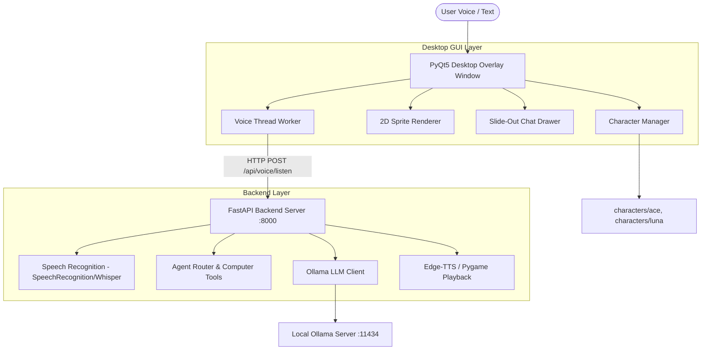
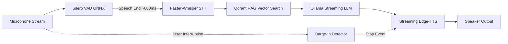

# 📘 Portgas D. Ace & Voice Assistant — Complete Project Analysis Document

> **Document Version:** 1.0.0  
> **Date:** September 16, 2026  
> **Author:** Antigravity AI Engineering Team  
> **Repository:** `Ace_Ai` (Portgas D. Ace Desktop AI Mate & Standalone Local Voice Assistant)

---

## 1. Executive Summary & System Overview

The **Ace_Ai** repository is a comprehensive, production-quality local AI ecosystem containing two tightly integrated desktop AI applications:

1. **Desktop AI Mate (Transparent Desktop Companion GUI)**:
   - A frameless, transparent, always-on-top desktop overlay built with **PyQt5**.
   - Features a **decoupled Character System** supporting modular 2D animated desktop companions (`Portgas D. Ace`, `Luna AI`, and custom user-imported characters).
   - Powered by a local **FastAPI** backend providing speech recognition, system tools execution, conversation history, and local LLM responses via **Ollama**.

2. **Standalone Continuous Local Voice Assistant (`voice_assistant/`)**:
   - A zero-cloud, low-latency conversational pipeline:
     $$\text{Microphone} \longrightarrow \text{Silero VAD ONNX} \longrightarrow \text{Faster-Whisper STT} \longrightarrow \text{Qdrant RAG} \longrightarrow \text{Ollama LLM} \longrightarrow \text{Sentence TTS} \longrightarrow \text{Barge-In Playback}$$
   - Features instant barge-in cancellation (interrupt speaking naturally or via `ESC`), continuous audio ring-buffering, sliding memory, and latency telemetry.

---

## 2. High-Level Architecture Diagrams

### 2.1 Desktop Companion Architecture



### 2.2 Standalone Voice Assistant Pipeline (`voice_assistant/`)



---

## 3. Comprehensive File-by-File Analysis

### 3.1 Project Root Files & Launchers

#### `run.py`
- **Role**: Primary entry point for launching the Desktop AI Companion application.
- **Mechanism**:
  - Uses `threading.Thread` to spin up the **FastAPI** backend server (`backend.main:app`) on `http://127.0.0.1:8000`.
  - Spawns the **PyQt5** transparent overlay GUI window (`desktop.window.AceDesktopWindow`).
- **Dependencies**: `uvicorn`, `PyQt5`, `backend.main`, `backend.config`.

#### `.env` & `.env.example`
- **Role**: Configuration templates for backend API hosts, ports, Ollama endpoints, Whisper devices, VAD thresholds, and Qdrant settings.

#### `requirements.txt`
- **Role**: Core dependencies specification.
- **Key Packages**:
  - `fastapi`, `uvicorn`, `httpx` (Backend server & HTTP streaming)
  - `PyQt5`, `pygame` (GUI desktop overlay & audio playback)
  - `sounddevice`, `onnxruntime` (Microphone input & Silero VAD)
  - `faster-whisper` (Speech-to-text transcription)
  - `qdrant-client`, `pypdf`, `python-docx` (Vector database & document parsing)
  - `edge-tts`, `pywin32` (Text-to-speech synthesis)
  - `keyboard` (Global hotkey hooks)

---

### 3.2 Desktop Companion UI Layer (`desktop/`)

#### `desktop/window.py`
- **Role**: Main transparent desktop overlay container window (`AceDesktopWindow`).
- **Key Responsibilities**:
  - Frameless, translucent background window flags (`Qt.FramelessWindowHint | Qt.WindowStaysOnTopHint`).
  - Houses the 2D `Sprite2DRenderer`, status pill badge, action control buttons (`💬 Chat`, `🎤 Voice Mode`), and slide-out chat drawer.
  - Position persistence (`config/desktop_position.json`) with multi-monitor boundary safety checks.
  - Right-click context menu (Chat, Voice Mode, Change Character, Character Settings, Always on Top, Hide, Exit).
  - Listens to system events and triggers floating `CharacterChatBubble` speech overlays.

#### `desktop/character_manager.py`
- **Role**: Manages character discovery, selection, manifest validation, and dynamic prompt injection.
- **Key Methods**:
  - `list_available_characters()`: Scans `characters/` folder for character subdirectories containing `character.json`.
  - `set_active_character(char_id)`: Saves active selection to `config/active_character.json`.
  - `validate_character_folder(folder_path)`: Checks character folder integrity and asset references.
  - `import_character_folder(folder_path)`: Imports custom user character packages into `characters/`.
  - `get_character_system_prompt()`: Generates Ollama system prompt framing based on active character personality profile.

#### `desktop/character_renderer.py`
- **Role**: Abstract character renderer interface (`CharacterRenderer`) and 2D implementation (`Sprite2DRenderer`).
- **Key Features**:
  - `QABCMeta`: Combines `QWidget` PySide/PyQt metaclass with Python's `ABCMeta` without type conflicts.
  - Procedural frame animations: Subtle breathing bounce loop during `IDLE`, animated talking mouth movement during `TALKING`/`SPEAKING`.
  - Supports PNG, GIF, APNG, WebP image formats, visual scale sliders, and opacity control.

#### `desktop/character_ui.py`
- **Role**: Dialog modals and floating chat bubble elements.
- **Components**:
  - `CharacterSelectionDialog`: Grid cards display available characters with `[Select]` and `[Import Character]` options.
  - `CharacterSettingsDialog`: Live character preview with scale slider, opacity slider, and test buttons (`[Test Idle]`, `[Test Talking]`, etc.).
  - `CharacterChatBubble`: Speech bubble overlay appearing adjacent to character companion when generating speech responses.

#### `desktop/chat_drawer.py`
- **Role**: Slide-out text chat drawer for typing messages, viewing conversation history, and checking tool execution logs.

#### `desktop/audio_worker.py`
- **Role**: Async QThread workers (`ChatWorker`, `VoiceWorker`) connecting PySide GUI threads to FastAPI backend endpoints.

#### `desktop/avatar.py`
- **Role**: Legacy 2D avatar renderer preserved for backward compatibility.

---

### 3.3 FastAPI Backend Layer (`backend/`)

#### `backend/main.py`
- **Role**: FastAPI application initialization, CORS middleware configuration, database table creation on startup, and router registration (`/api/chat`, `/api/voice`).

#### `backend/config.py`
- **Role**: Application settings loader reading environment variables.

#### `backend/database.py`
- **Role**: SQLite database connection and conversation logs storage.

#### `backend/api/chat.py`
- **Role**: REST endpoint (`POST /api/chat`) handling text chat, tool intent parsing, Ollama generation, and conversation persistence.

#### `backend/api/voice.py`
- **Role**: REST endpoint (`POST /api/voice/listen`) handling voice turn capture, speech recognition, tool routing, LLM response generation, and TTS audio synthesis.

#### `backend/llm/ollama_client.py`
- **Role**: Async HTTP client for communicating with local Ollama server (`http://localhost:11434/api/chat`). Supports multi-thread CPU settings (`num_thread: 8`) and short context windows (`num_ctx: 512`) for ultra-low latency.

#### `backend/llm/prompts.py`
- **Role**: System prompt builder dynamically integrating `CharacterManager.get_character_system_prompt()` and user context memories.

#### `backend/speech/stt_engine.py`
- **Role**: Speech recognition engine using PyAudio / SpeechRecognition with ambient noise adjustment.

#### `backend/speech/tts_engine.py`
- **Role**: Text-to-speech engine utilizing `edge-tts` (or SAPI5 fallback) to save mp3 audio and play via `pygame.mixer`.

#### `backend/agent/agent.py` & `backend/agent/tools.py`
- **Role**: Intent router parsing natural language requests to safely trigger local desktop tools (`get_time`, `get_system_info`, `open_website`, `open_application`, `search_web`).

---

### 3.4 Standalone Voice Assistant Pipeline (`voice_assistant/`)

#### `voice_assistant/app.py`
- **Role**: Main application entry point for the standalone zero-cloud voice assistant. Runs startup health checks for Microphone, Ollama, Qdrant, STT, and TTS engines.

#### `voice_assistant/ingest.py`
- **Role**: CLI document ingestion tool for RAG vector search (`python voice_assistant/ingest.py --path voice_assistant/data/documents`). Parses `.txt`, `.md`, `.pdf`, `.docx`, chunks text, generates embeddings, and upserts into Qdrant.

#### `voice_assistant/config.py`
- **Role**: Pydantic settings loading `.env` values (`WHISPER_MODEL`, `VAD_THRESHOLD`, `QDRANT_URL`, etc.).

#### `voice_assistant/audio/`
- `microphone.py`: Non-blocking continuous `sounddevice` ring-buffer stream (16kHz mono PCM).
- `vad.py`: PyTorch/ONNX Silero VAD engine determining speech start, continuous speech, and end-of-speech silence (~600ms).
- `audio_utils.py`: Converts int16 PCM audio buffers to float32 NumPy arrays.

#### `voice_assistant/stt/`
- `base.py`: Abstract STT provider base class.
- `whisper.py`: `FasterWhisperSTT` implementation supporting English, Hindi, and Hinglish with beam size 1 and Whisper hallucination filtering.

#### `voice_assistant/rag/`
- `document_loader.py`: Document loader supporting text, markdown, PDF (`pypdf`), and Word (`python-docx`).
- `chunker.py`: Recursive document chunker (`CHUNK_SIZE=800`, `CHUNK_OVERLAP=150`).
- `embeddings.py`: Ollama embedding provider (`nomic-embed-text`) with deterministic hash fallback.
- `vector_store.py`: Qdrant vector database store manager (supports remote Qdrant server or local disk storage `./data/qdrant`).
- `retriever.py`: Semantic top-K retriever fetching relevant knowledge chunks for Ollama prompts.

#### `voice_assistant/llm/`
- `ollama.py`: Async streaming Ollama LLM provider yielding tokens in real time.
- `prompts.py`: Voice assistant system prompt framing.

#### `voice_assistant/tts/`
- `base.py`: Abstract TTS provider base class.
- `local_tts.py`: `LocalTTSProvider` utilizing `edge-tts` in isolated thread pools and `pygame.mixer` with thread-safe `stop_sync()` for instant barge-in cancellation.

#### `voice_assistant/conversation/memory.py`
- **Role**: Sliding-window conversation memory manager (`MAX_HISTORY_MESSAGES=20`).

#### `voice_assistant/core/`
- `assistant.py`: Master orchestrator (`VoiceAssistantOrchestrator`) coordinating audio capture, VAD turn detection, STT transcription, RAG retrieval, LLM streaming, sentence splitting, TTS playback, and live barge-in monitoring.
- `state.py`: Thread-safe `AssistantState` enum state machine (`IDLE`, `LISTENING`, `TRANSCRIBING`, `RETRIEVING`, `THINKING`, `SPEAKING`, `INTERRUPTED`, `ERROR`).
- `events.py`: Latency tracker logging telemetry metrics (`Speech detected`, `STT completed`, `RAG completed`, `First LLM token`, `First TTS audio`).

#### `voice_assistant/tools/keyboard.py`
- **Role**: Global keyboard hotkey listener (`F8`=Activate, `ESC`=Interrupt, `F9`=Mute/Unmute).

#### `voice_assistant/tests/`
- `test_vad.py`: Unit tests for VAD audio buffer processing.
- `test_memory.py`: Unit tests for conversation sliding window memory.
- `test_rag.py`: Unit tests for text chunking and retriever.

---

### 3.5 Character Packages & Manifests (`characters/` & `config/`)

#### `characters/ace/character.json`
- Manifest for default **Portgas D. Ace** character package containing asset mapping (`idle.png`, `listening.png`, `thinking.png`, `talking.png`, `happy.png`, `confused.png`), settings, and energetic personality profile.

#### `characters/luna/character.json`
- Manifest for sample **Luna AI** character package featuring a calm, intelligent, and polite personality profile.

---

## 4. Execution & Setup Instructions

### ⚠️ Common Error: `ModuleNotFoundError: No module named 'PyQt5'`

If you encounter `ModuleNotFoundError: No module named 'PyQt5'` when running `python run.py`, it means the command ran using your global Python installation (`C:\Users\...\Python311\python.exe`) where packages are not installed, instead of the virtual environment (`.venv`).

### Solution: Always activate `.venv` or use `.venv\Scripts\python.exe`.

#### Windows Command Prompt (`cmd.exe`):
```cmd
cd /d D:\Ace_Ai
.venv\Scripts\activate.bat
python run.py
```

#### Windows PowerShell:
```powershell
cd D:\Ace_Ai
.\.venv\Scripts\activate
python run.py
```

#### Running Standalone Continuous Voice Assistant:
```cmd
.venv\Scripts\activate.bat
python voice_assistant\app.py
```

#### Ingesting Documents into RAG:
```cmd
python voice_assistant\ingest.py --path voice_assistant\data\documents
```

---

## 5. Summary Matrix of File Modules

| Module Path | Layer | Primary Responsibility | Dependencies |
|---|---|---|---|
| `run.py` | Launcher | Launches FastAPI backend + PyQt5 desktop GUI | `uvicorn`, `PyQt5` |
| `desktop/window.py` | Desktop UI | Transparent overlay container, drag, context menu | `PyQt5` |
| `desktop/character_manager.py` | Desktop UI | Character discovery, import validation & system prompt | `json`, `shutil` |
| `desktop/character_renderer.py` | Desktop UI | Abstract & 2D frame animation renderer (`QABCMeta`) | `PyQt5` |
| `desktop/character_ui.py` | Desktop UI | Selection grid modal, settings preview & chat bubble | `PyQt5` |
| `backend/main.py` | Backend Server | FastAPI server initialization & router setup | `fastapi`, `uvicorn` |
| `backend/api/voice.py` | Backend API | Voice endpoint handling audio transcription & TTS | `fastapi`, `speech_recognition` |
| `backend/llm/ollama_client.py` | Backend LLM | Async Ollama LLM HTTP client | `httpx` |
| `voice_assistant/app.py` | Voice Assistant | Standalone pipeline launcher & health checks | `sounddevice`, `faster-whisper` |
| `voice_assistant/core/assistant.py` | Voice Core | Pipeline orchestrator & barge-in monitor | `asyncio`, `onnxruntime` |
| `voice_assistant/audio/vad.py` | Voice Audio | Silero VAD turn detection engine | `onnxruntime`, `numpy` |
| `voice_assistant/stt/whisper.py` | Voice STT | Local speech transcription with hallucination filter | `faster-whisper` |
| `voice_assistant/rag/vector_store.py` | Voice RAG | Qdrant vector store manager (server / disk fallback) | `qdrant-client` |
| `voice_assistant/tts/local_tts.py` | Voice TTS | Edge-TTS streaming playback & instant barge-in | `edge-tts`, `pygame` |
