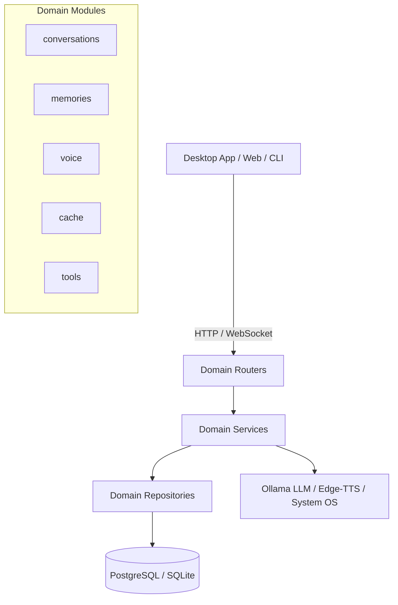
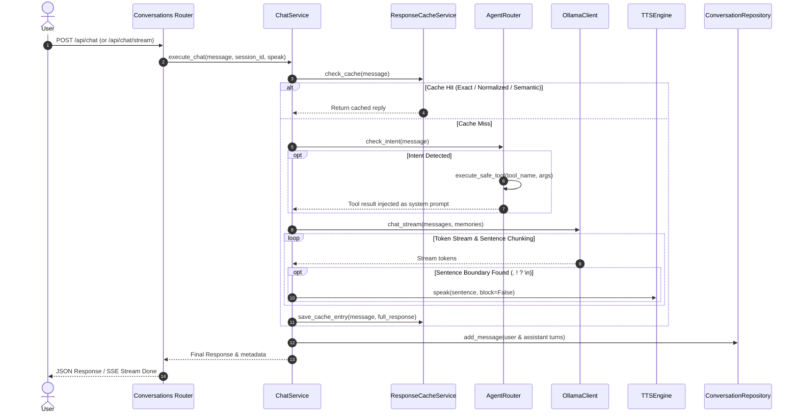

# 🏛️ Architecture & System Blueprint

This document details the architectural principles, domain decomposition, design patterns, and request lifecycle of the **Ace_Ai** system.

---

## 1. Domain-Driven Design (DDD) Overview

The backend is structured into clear, decoupled domain packages under `backend/`. Each domain encapsulates its own models, schemas, repositories, services, and HTTP routers:



### Domain Module Structure
Each domain module contains:
- **`models.py`**: SQLAlchemy database entities inheriting from `BaseAuditModel` (`id`, `created_at`, `updated_at`, `is_active`).
- **`schemas.py`**: Pydantic models for request validation, response serialization, and DTO contracts.
- **`repository.py`**: Data access layer isolating database queries, transactions, and filters.
- **`service.py`**: Pure business logic orchestrating repositories, LLM streaming, audio synthesis, and tools.
- **`router.py`**: FastAPI endpoints binding HTTP paths to domain service methods.

---

## 2. Core Architectural Patterns

### A. Repository Pattern
Data queries are completely decoupled from business logic and controllers.
- `ConversationRepository` manages message turns and token budgeting.
- `MemoryRepository` manages long-term facts, preferences, and categories.
- `CacheRepository` manages exact and normalized prompt query cache entries.

### B. Service Layer Pattern
Encapsulates application workflow:
- `ChatService` handles multi-tier cache evaluation, intent detection, Ollama streaming, and real-time sentence-level TTS dispatch.
- `MemoryService` coordinates validation and persistence of memory records.
- `TTSEngine` provides non-blocking audio generation with instant barge-in cancellation.

### C. Base Audit Pattern (`BaseAuditModel`)
Every database entity derives from `BaseAuditModel` in [`backend/common/models.py`](file:///D:/Ace_Ai/backend/common/models.py):
```python
class BaseAuditModel(Base):
    __abstract__ = True
    id = Column(Integer, primary_key=True, index=True)
    created_at = Column(DateTime, default=datetime.utcnow, nullable=False)
    updated_at = Column(DateTime, default=datetime.utcnow, onupdate=datetime.utcnow, nullable=False)
    is_active = Column(Boolean, default=True, nullable=False)
```
Guarantees audit traceability across conversation messages, user preferences, and cache records.

### D. Facade Pattern for Backward Compatibility
To guarantee that existing test benches, desktop GUI (`desktop/window.py`), and CLI scripts continue working with zero modification:
- `backend/config.py` re-exports from `backend.core.config`.
- `backend/memory/database.py` re-exports models and engine from `backend.core.database`.
- `backend/memory/conversation.py` re-exports methods delegating to repositories.
- `backend/speech/tts_engine.py` re-exports the singleton from `backend.voice.service`.

---

## 3. End-to-End Chat Turn Lifecycle

When a user submits a prompt via desktop chat drawer, voice mic, or REST API:


