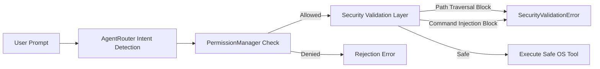

# 🛡️ Desktop Tools & Security Manual

This document details the desktop automation tools, intent classification router, permission management, and security sandboxing safeguards under `backend/tools/` and `backend/agent/`.

---

## 1. Security Architecture & Threat Defenses

Because Ace AI can interact with the host operating system, strict defensive controls are enforced at every level:



### Key Defensive Safeguards

1. **Path Traversal Sandboxing:**
   - Functions `resolve_workspace_path()` and `_is_path_allowed()` resolve all relative and canonical path segments.
   - Any attempt to escape the designated workspace directory via `../`, `..\`, absolute system drive roots (`C:\Windows`), or symbolic links raises `SecurityValidationError`.

2. **Command Injection Prevention:**
   - Regex patterns explicitly reject shell metacharacters (`&`, `|`, `;`, `` ` ``, `$()`, `>`, `<`, `\n`).
   - Tools never invoke raw shell execution (`shell=True`). Applications are launched strictly using vetted binary names via `subprocess.Popen([app_path])`.

---

## 2. Desktop Tools Reference: `backend/agent/tools.py`

**File Location:** [`backend/agent/tools.py`](file:///D:/Ace_Ai/backend/agent/tools.py)

| Tool Function | Parameters | Description |
| :--- | :--- | :--- |
| `open_application(app_name: str)` | Application name or alias | Launches vetted desktop applications (e.g. `"notepad"`, `"calc"`, `"chrome"`, `"explorer"`). Rejects unauthorized system binaries. |
| `create_file(path: str, content: str)` | Target file path, file content | Safely writes text content to a file inside the confined workspace root. |
| `read_file(path: str)` | Target file path | Safely reads up to 50KB from a text file within the workspace. |
| `list_files(directory: str)` | Relative directory path | Lists names and sizes of files within an allowed workspace directory. |
| `get_system_info()` | None | Retrieves OS version, CPU architecture, platform, and hostname. |
| `get_current_time()` | None | Returns formatted local date and time string. |

### `execute_safe_tool(tool_name: str, **kwargs) -> str`
Executes a requested tool from `TOOL_MAP` inside a monitored try-except block, returning human-readable execution results or formatted error messages.

---

## 3. Agent Router & Intent Detection: `backend/agent/agent.py`

**File Location:** [`backend/agent/agent.py`](file:///D:/Ace_Ai/backend/agent/agent.py)

### Class: `AgentRouter`
Scans incoming user prompts for desktop tool intents:

* **`check_intent(prompt: str) -> Optional[Tuple[str, Dict[str, Any]]]`**:
  - Matches prompt against pattern rules for time queries, app opening, file operations, and system queries.
  - Returns `(tool_name, tool_args)` tuple if matched, or `None` for standard conversational flow.
* **`execute_tool(tool_name: str, args: Dict[str, Any]) -> str`**:
  - Verifies permissions with `permission_manager`.
  - Dispatches execution to `execute_safe_tool`.

---

## 4. Permission Manager: `backend/agent/permissions.py`

**File Location:** [`backend/agent/permissions.py`](file:///D:/Ace_Ai/backend/agent/permissions.py)

### Class: `PermissionManager`
Regulates tool execution authority:

```python
class PermissionLevel(Enum):
    AUTO = "auto"       # Read-only tools (time, system info, safe read) run automatically
    ASK  = "ask"        # Destructive tools (write, delete) prompt user for confirmation
    DENY = "deny"       # Restricted tools are completely blocked
```

* **`is_tool_allowed(tool_name: str) -> bool`**: Returns whether the tool has permission to execute.
* **`set_permission(tool_name: str, level: PermissionLevel) -> None`**: Configures runtime permission level for a tool.
