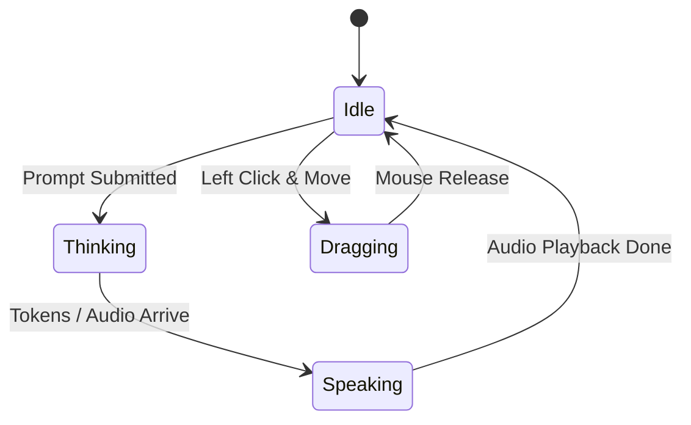

# 🖥️ Desktop GUI & Living Avatar Manual

This document details the transparent desktop overlay window, character manager, 2D sprite & 3D GLTF renderers, gaze tracking, animation state machines, and Qt widgets under `desktop/`.

---

## 1. Main Window Architecture: `desktop/window.py`

**File Location:** [`desktop/window.py`](file:///D:/Ace_Ai/desktop/window.py)

### Class: `MainWindow(QMainWindow)`
Provides the transparent, always-on-top desktop avatar companion window.

#### Window Properties & Flags
- `Qt.WindowType.FramelessWindowHint`: Removes standard OS window titlebar and borders.
- `Qt.WindowType.WindowStaysOnTopHint`: Keeps the character floating above all desktop applications.
- `Qt.WA_TranslucentBackground`: Renders a transparent alpha-channel background, showing only the character sprite or 3D model.

#### Interaction Controls
- **Window Dragging:** Left-click and hold anywhere on the character to drag across the desktop. Character switches to a dragging animation state.
- **Context Menu:** Right-click opens options to toggle Chat Drawer, view Long-Term Memories, switch characters, or exit.
- **System Tray Icon:** Minimizes companion to the Windows system tray with a persistent icon.

---

## 2. Living Character Avatar: `desktop/living_character.py`

**File Location:** [`desktop/living_character.py`](file:///D:/Ace_Ai/desktop/living_character.py)

### Class: `LivingCharacterWidget(QWidget)`
Simulates natural lifelike behavior through physics and animation controllers:

#### Behavioral Subsystems
1. **Gaze & Eye Tracking:**
   - Detects cursor coordinates across the desktop screen.
   - Smoothly clamps and shifts pupil offsets so the avatar appears to look at the user's mouse.
2. **Natural Blinking:**
   - Random timer triggers eyelid closure every 3-6 seconds.
3. **Idle Breathing:**
   - Sinusoidal floating and breathing offsets create subtle vertical movement.
4. **Lip-Sync (Mouth Movement):**
   - When `TTSEngine` reports active speech, alternates mouth sprites to simulate talking.

---

## 3. Character Manager: `desktop/character_manager.py`

**File Location:** [`desktop/character_manager.py`](file:///D:/Ace_Ai/desktop/character_manager.py)

### Class: `CharacterManager`
Handles switching between multiple avatar characters and models:
- Reads manifest files from `characters/<character_name>/character.json`.
- Supports 2D sprite sheets (`assets/sprites/`) and 3D GLTF/GLB models (`assets/models/`).
- Maps animation states (`idle`, `talk`, `drag`, `happy`) to texture frames or 3D animations.

---

## 4. Chat Drawer: `desktop/chat_drawer.py`

**File Location:** [`desktop/chat_drawer.py`](file:///D:/Ace_Ai/desktop/chat_drawer.py)

### Class: `ChatDrawerWidget(QFrame)`
Slide-out modern glassmorphism chat panel providing:
- **Conversation Bubbles:** Visually separates user messages from Ace's replies.
- **Markdown & Code Highlighting:** Renders Python, JavaScript, and shell code with syntax formatting.
- **Microphone Toggle:** Button to activate STT voice capture without touching the keyboard.
- **Instant Cancel / Interrupt:** Barge-in button to immediately silence ongoing voice playback.

---

## 5. Audio Worker: `desktop/audio_worker.py`

**File Location:** [`desktop/audio_worker.py`](file:///D:/Ace_Ai/desktop/audio_worker.py)

### Class: `AudioWorker(QThread)`
Isolates audio recording and sound playback into a background `QThread`:
- Emits Qt signals (`speech_started`, `speech_finished`, `transcript_ready`) back to the main UI thread.
- Ensures the 60 FPS animation loop of the desktop avatar never stutters during network requests or sound decoding.
